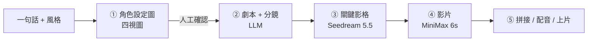

# 06 · 分段製作流程（角色 → 劇本 → 分鏡 → 出圖 → 影片 → 後製）

> 版本：0.4　更新：2026-11-22
> 這份文件說明 web 工作室上「有閘門的分段流程」，以及每一步的 API、資料欄位與實測數據。

## 為什麼要分段

早期版本是「一句話 → 直接 4 鏡 → 逐鏡出圖」，問題是：

1. **角色會漂移**：每鏡各自生成，臉與服裝不一致。
2. **沒有確認點**：花錢生成影片後才發現角色不對。
3. **劇本與畫面脫節**：分鏡是固定模板，沒有依故事展開。

因此改成四個閘門：**角色確認 → 劇本分鏡 → 出圖 → 影片**。



## ① 角色階段

**目的**：先把角色「定裝」——四視圖設定圖（正面／四分三／側面／背面）＋固定描述。

- 生成模型：火山 Agent Plan `doubao-seedream-5.5`（`watermark:false`）
- 提示詞骨架：

```text
character design sheet, full body, front / three-quarter / side / back views
on a neutral grey background, consistent proportions, {角色描述}, {專案風格},
clean lighting, no text
```

- 角色資料存進 `plan.cast[]`：

```json
{ "id": "C1", "name": "夜市廚師",
  "description": "二十多歲韓系男子，短黑髮，深藍圍裙，白色短袖…",
  "sheet": "sheet-C1-589592.png", "status": "draft" }
```

- 操作：**確認角色**（`status: approved`）或 **重生**（重畫並回到 draft）。
- **閘門**：沒有任何 `approved` 角色時，劇本 API 直接拒絕（避免用漂移的角色拍片）。

| API | 方法 | 說明 |
| --- | --- | --- |
| `/api/projects/<pid>/characters` | POST | `{name, description}` → 生成設定圖 |
| `/api/projects/<pid>/characters/<cid>/approve` | POST | 確認角色 |
| `/api/projects/<pid>/characters/<cid>/regenerate` | POST | 重畫設定圖（回到 draft） |

實測：每張設定圖約 **20 秒**（Seedream 5.5，1024×1024）。

## ② 劇本與分鏡階段

**目的**：用「已確認的角色」寫劇本節拍與分鏡，角色外觀寫進每一鏡的英文 prompt。

- 模型：阿里 `qwen3.7-plus`（可用 `glm-5.2` 備援）
- 輸入：故事一句話、風格、已確認角色清單（id／名稱／描述）
- 輸出 JSON：`{beats:[{beat, description}], shots:[{beat, framing, camera, action, lighting, positive_prompt, character_ids}]}`
- 攝影機只接受既有 15 種 canonical movement（`locked/pan/…/drone`），不合規就退回 `locked`。
- 寫回：`plan.script = {synopsis, beats}`、`plan.shots = [...]`（影像／影片欄位重置）、`plan.stage = "storyboard"`。

| API | 方法 | 說明 |
| --- | --- | --- |
| `/api/projects/<pid>/script/expand` | POST | 依已確認角色產生劇本＋分鏡（需至少 1 個 approved 角色） |

實測：生成 4 鏡約 **60 秒**（含 LLM 回應）。

## ③ 出圖階段

- 每鏡 `POST /api/projects/<pid>/shots/<sid>/image`
- 預設模型：火山 Agent Plan `doubao-seedream-5.5`（備援：標準 Ark Seedream、MiniMax `image-01`）
- prompt = 作者的 `positive_prompt`（已含角色描述）＋運鏡句＋風格
- 實測：每張約 **15–25 秒**

## ④ 影片階段

| 來源 | 支援 | 限制 |
| --- | --- | --- |
| **MiniMax `MiniMax-Hailuo-02`** | ✅ 已開通 | 只收 **6 / 10 秒**；`512P/768P/1080P` |
| MiniMax `T2V-01` / `I2V-01` | 可用 | `I2V-01` 實測在 Preparing 卡 10 分鐘後 Fail，暫不建議 |
| 火山 `doubao-seedance-2-5-flash` | 待開通 | 方舟「開通管理」開通後即可 |
| 地端 LTXV 2B | 可用（草稿） | 3 秒約 7 分鐘；畫質僅草稿 |
| 地端 Wan2.2 | 不可用 | gfx1030 8 分鐘/步 |

- 每鏡獨立任務，失敗只影響該鏡（`job.state = error`）。
- 實測：MiniMax 6 秒 768P **75–90 秒/鏡**。

## ⑤ 後製階段

1. 正規化：`scale=1280:720`（原生，不放大）＋`fps=24`＋`yuv420p`
2. 拼接：concat demuxer → 依專案片長裁切（例：4×6 秒 = 24.0 秒）
3. 配音：MiniMax TTS `speech-2.5-hd-preview`（回傳為 **hex**，注意解碼）
4. 環境音：ffmpeg 合成（pink noise 濾波），標註為合成音效
5. 混音：`amix`＋`loudnorm=I=-16:TP=-1.5:LRA=11`＋片尾淡出
6. 封面：`ffmpeg -ss 2 -frames:v 1`
7. 上傳：`POST /api/projects/<pid>/uploads`（512 MB 上限）

## 資料模型（plan.json 新增欄位）

```json
{
  "stage": "character | storyboard | image | video | done",
  "cast": [ { "id": "C1", "name": "...", "description": "...",
              "sheet": "sheet-C1-xxxx.png", "status": "draft|approved" } ],
  "script": { "synopsis": "...", "beats": [ { "beat": "建立", "description": "..." } ] },
  "shots": [ { "id": "S01", "character_ids": ["C1"], "video_provider": "minimax" } ]
}
```

## 網頁操作順序

1. 建立專案（一句話／風格／片長／比例）
2. 填入角色描述 → **生成角色設定圖** → 檢查四視圖 → **確認角色**（可多個角色）
3. 按 **② 生成劇本與分鏡**
4. 逐鏡按 **生成關鍵影格**（可先改 prompt／運鏡）
5. 逐鏡按 **生成影片**（來源預設 MiniMax）
6. 在「上傳素材」區確認成品，或用 ffmpeg 拼接

## 已知限制

| 限制 | 影響 | 下一步 |
| --- | --- | --- |
| 角色只靠**文字鎖**，沒有圖像條件 | 四鏡的臉仍有差異 | **I2V 一致性**（見下） |
| MiniMax 只收 6/10 秒 | 5 秒級節奏需裁切 | 用 T2V-01 或裁切 |
| 無「一鍵全跑」 | 每鏡需按一次 | 批次端點（可選） |
| 環境音為合成 | 非真實夜市聲 | 外部音效庫或 TTS 描述 |

## 角色一致性（已實作，2026-11-22）

三層機制，全部已接進網站：

1. **出圖帶參考圖**：關鍵影格生成時，把 `cast[].sheet`（角色設定圖）以 **data URI** 放進
   Seedream 5.5 的 `image` 欄位（實測接受，單張或陣列皆可）。
   → 同一角色在四鏡的臉型、髮型、服裝一致。
2. **影片首幀**：該鏡的關鍵影格自動作為 H3 的 `first_frame`（`role=first_frame`）。
3. **運鏡限制**：`orbit_180`/`orbit_360` 會轉到首幀看不到的空間，模型會「發明」場景
   （實例：台灣夜市 S03 變成日式居酒屋）。需要一致性時優先用 `dolly_in`／`tracking`／`locked`。

已知仍會漂移的情況：多人同鏡時模型可能交換臉部細節；極端角度（仰拍、背面）仍需人工挑圖。

## 下一步：I2V 角色一致性（已完成，保留原始規劃）

**問題**：目前 keyframe 只用文字描述角色，臉部在四鏡之間會變。

**做法**（依序）：

1. **首幀條件**：S01 用角色設定圖的正面裁切圖當 first frame，之後每鏡用前一鏡的最後一格 → 連續性是「延續」而不是「重新生成」。
2. **參考圖條件**：Ark Seedream 5.5 支援 image 參考（`images/generations` 的 `image` 欄位）；把設定圖上傳到可公開存取的位置（或 data URI，需實測）作為風格／身份參考。
3. **I2V 模型選擇**：MiniMax `I2V-01` 目前不穩；優先 `MiniMax-Hailuo-02` 的 first_frame 模式（已驗證 77 秒完成）。
4. **驗收**：同一角色在三鏡中的臉部相似度（可用視覺模型打分，或人工比對）。

**預期效果**：臉部漂移從「每鏡重算」變成「只算一次」；代價是每鏡生成時間略增（I2V 與 T2V 同級）與 first frame 需先產出。
